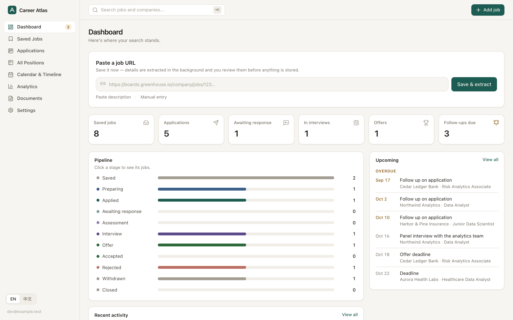
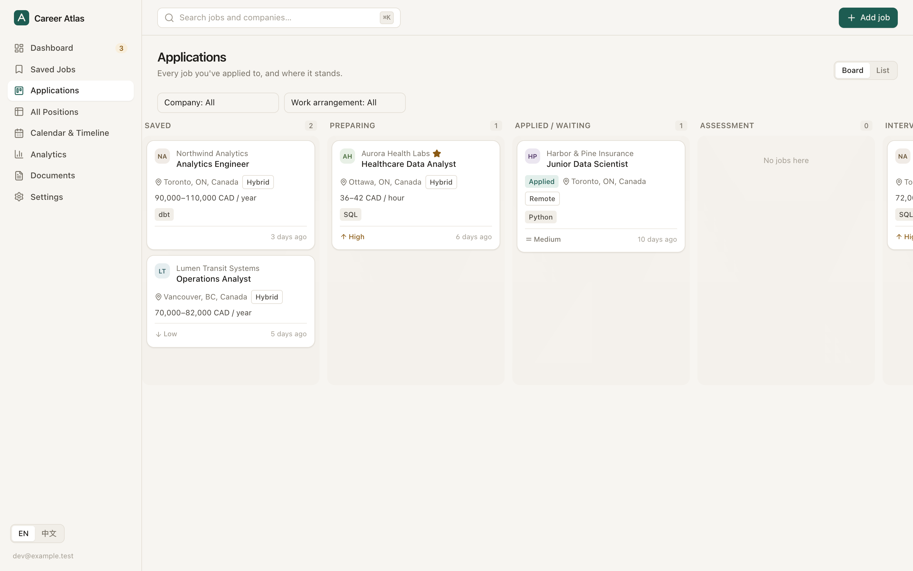
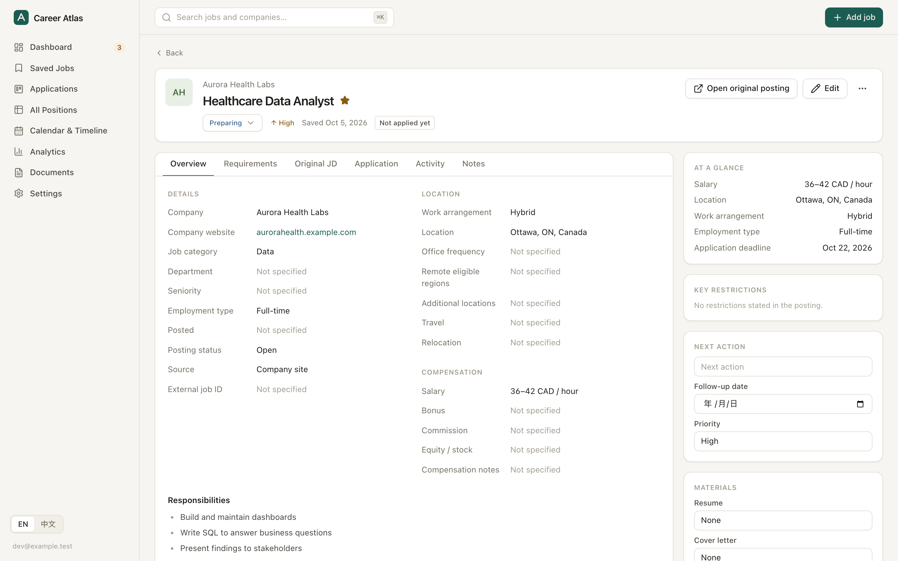
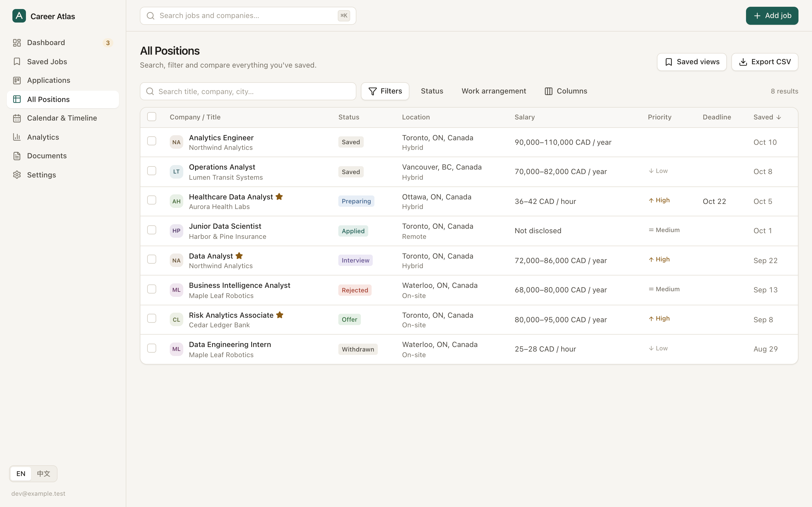
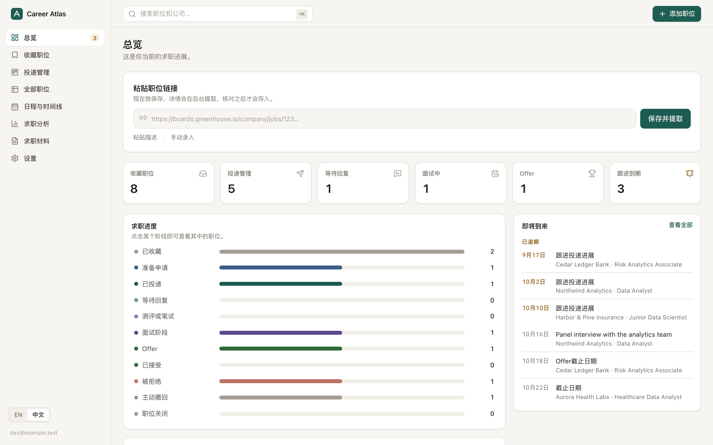
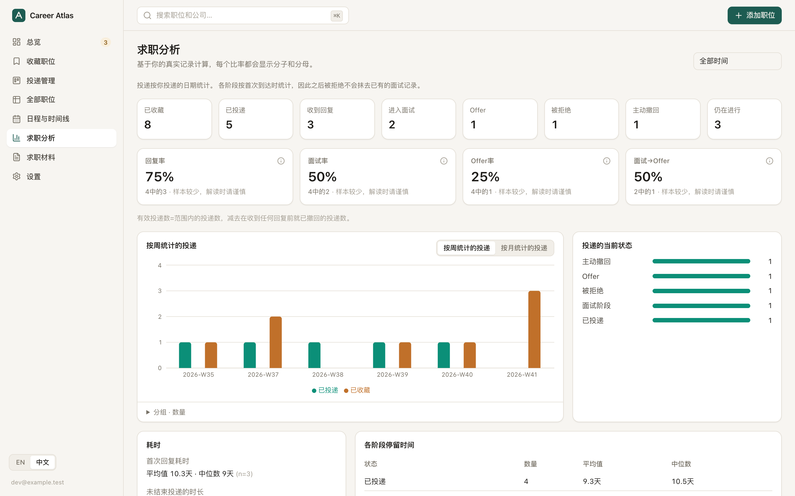

# Career Atlas

**Save a job. Understand the job. Track the application. Never lose the context.**

[简体中文说明 →](README.zh-CN.md)

Career Atlas is a private, local-first, bilingual (English / 简体中文) job-search workspace. It runs as a website on your own computer (`http://127.0.0.1:4310`), saves everything automatically to a local SQLite database and makes weekly encrypted backups. No cloud account, server or subscription is required; AI extraction through your own Claude Code sign-in is optional.

Paste a job link. Career Atlas saves it right away, reads the posting in the background, and shows each extracted field with its source and a verbatim quote. You review everything before it is stored. After that it tracks your application through every stage, with a history you can audit.

> Status: pre-release (v0.2, local-first). Single-user. See [HANDOFF.md](HANDOFF.md) for what is implemented, tested and deployed.

## Screenshots

_All data shown is fictional demo data (`npm run db:seed:demo`)._

| Dashboard | Kanban board |
|---|---|
|  |  |
| **Job detail with provenance** | **All Positions** |
|  |  |
| **中文界面** | **Analytics (中文)** |
|  |  |

## Features

- **Capture first, enrich second.** URL, pasted job description or manual entry. A link is saved even if the site can't be read.
- **Honest extraction.** Sources are tried in this order: public ATS APIs (Greenhouse, Lever, Ashby, SmartRecruiters, Workday), then schema.org `JobPosting` JSON-LD, then page text. After that come rule-based extraction and optional AI.
  - Every value records its source, evidence, confidence and review status.
  - Unknown stays unknown. AI salary or visa claims without a matching quote in the posting are discarded.
- **Human in the loop.** You review extractions before saving. Manual edits are kept as overrides alongside the original extracted value.
  - "Refresh from source" shows a diff, and you choose which changes to apply.
- **Saved ≠ Applied.** Job posting, saved job and application are separate records. Pipeline: Saved → Preparing → Applied → … → Offer, Accepted, Rejected or Withdrawn.
  - Status history is append-only.
- **Kanban board** with drag-and-drop and keyboard support. Moves are optimistic, rolled back on failure, and recorded as events.
- **All Positions table** with combinable filters:
  - work arrangement, salary floor (same currency and pay period only), restrictions, skills, tags, dates, needs-review and more
  - saved views, bulk actions and CSV export
- **Job detail** with evidence popovers, the original JD snapshot history (searchable, kept after the link dies), application dates, timeline, notes and reminders.
- **Compare 2–4 jobs** side by side, with an explainable preference score. It is not a hiring prediction.
- **Calendar and timeline** (month and list views), reminders, configurable follow-up nudges and `.ics` export.
- **Analytics** with explicit numerators and denominators. Milestone-based conversion means a rejection after an interview still counts as an interview.
- **Documents.** Resume and cover-letter versions stored as local files (never uploaded) and linked to applications.
- **Automatic saving** with a Saving / Saved / Failed indicator, and a warning before closing the tab with unsaved text.
- **Backup.** Weekly encrypted, self-verifying backups (26 kept), Back up now / Test restore in Settings, plus JSON/CSV export and JSON import with preview and duplicate skipping.
- **Bilingual from the ground up**: real-time EN / 中文 switching that keeps your current state.

## What it does *not* do

Career Atlas does not:

- bypass logins, CAPTCHAs or bot protection
- fetch LinkedIn, Indeed or Glassdoor pages automatically (their terms prohibit it; paste the description instead)
- guess salaries
- predict who will hire you
- send applications for you

Gmail, Google Calendar and a browser extension are planned but **not** implemented. See [ARCHITECTURE.md](ARCHITECTURE.md#future-extensions).

## Quick start

Requires macOS (Linux works too, minus the launcher) and Node.js ≥ 22.16.

```bash
git clone https://github.com/<you>/career-atlas.git && cd career-atlas
npm install
npm run start:local -- --open        # builds on first run, then opens http://127.0.0.1:4310
npm run launcher:install             # optional (macOS): "Career Atlas" app that starts it and opens the browser
```

Your data is created in `~/Library/Application Support/CareerAtlas/` — outside the source folder, so updating or re-cloning the code never touches it. Everyone who clones the project gets their own independent, empty database. See **[docs/LOCAL_FIRST.md](docs/LOCAL_FIRST.md)** for data locations, backups and restore, and optional Claude AI.

## Commands

| Command | What it does |
|---|---|
| `npm run start:local` / `npm run stop:local` | Run Career Atlas for everyday use (personal database); `-- --open`, `-- --detach` |
| `npm run launcher:install` | Create the macOS launcher app |
| `npm run local -- status` | Data location, schema version, row counts, backups, AI |
| `npm run local -- backup` / `backups` / `verify` / `restore …` | Encrypted, verified backups and restores (see LOCAL_FIRST.md) |
| `npm run local -- claude-check [--sample]` | Check the optional Claude Code integration |
| `npm run dev` | Development: API on a separate dev database (`.dev-data/`) + Vite HMR on http://127.0.0.1:5173 |
| `CAREER_ATLAS_INSTANCE=dev npm run local -- seed-demo` | Fictional demo data for the dev database (refused for the personal one) |
| `npm test` | Unit tests, API integration tests on the real runtime (temporary SQLite databases), runtime safety tests |
| `npm run test:e2e` | Playwright against the production build with a throwaway database; `test:e2e:live` adds live job boards |
| `npm run typecheck` / `npm run build` | Type checking / production build |
| `npm run db:generate` · `db:check` · `db:test-upgrade` · `db:lock` | Migrations: generate, immutable history, upgrade test with synthetic data, lock |
| `npm run check:secrets` | Scan for secrets, personal emails, databases and dumps (also a pre-commit hook) |

## Documentation

- [ARCHITECTURE.md](ARCHITECTURE.md): system design, extraction pipeline, decisions
- [DATABASE_SCHEMA.md](DATABASE_SCHEMA.md): entities, relationships, integrity rules
- [SECURITY.md](SECURITY.md): threat model, controls, reporting vulnerabilities
- [docs/LOCAL_FIRST.md](docs/LOCAL_FIRST.md): running locally, data locations, autosave, backups and restore, Claude AI, feature parity
- [docs/DATA_PROTECTION.md](docs/DATA_PROTECTION.md): how personal data stays private and safe across updates and schema changes
- [TESTING.md](TESTING.md): test strategy and acceptance coverage
- [HANDOFF.md](HANDOFF.md): implemented, tested and deployed status, next steps
- [CONTRIBUTING.md](CONTRIBUTING.md) · [docs/RELEASE_CHECKLIST.md](docs/RELEASE_CHECKLIST.md) · [docs/REFERENCE_RESEARCH.md](docs/REFERENCE_RESEARCH.md)

## License

[MIT](LICENSE).
